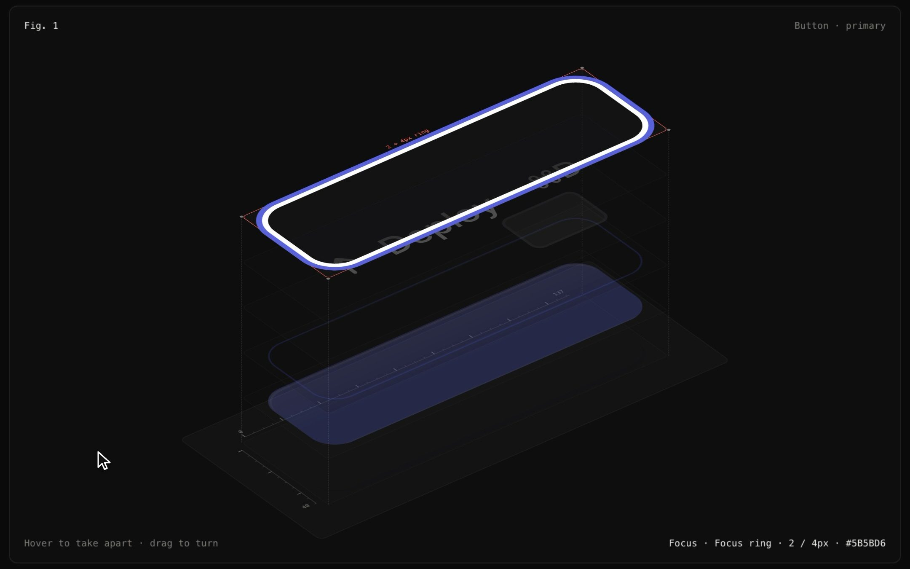

# Exploded

**Take a real UI component apart.** A skill for Claude Code, plus the runtime it uses.

Name a component and Claude renders it, then pulls it apart in isometric into its paint layers: elevation, surface, stroke, inner surfaces, content and focus ring. You can switch its states and read every measurement and design token right off the layers.

[](assets/demo.mp4)

**[Live demo](https://diip3sh.github.io/exploded/)** · **[Watch the video](assets/demo.mp4)**

## The rule

**Nothing is redrawn, and no number is typed.**

- Every layer is the live component, cloned with the browser's own computed styles. Any paint that belongs to another layer is made transparent.
- Every number comes from `getComputedStyle`, layout boxes and text ranges.
- Every token name comes from the CSS rule the author actually wrote.

So the spec sheet can't drift from what ships.

## What you get

- **Layers, found automatically.** Elevation, Surface, Stroke, inner surfaces (chips, thumbs, avatars), Content and Focus ring. Light paint (like white text) gets a backing in the colour of the surface it really sits on.
- **Every state.** Hover, focus, pressed, disabled, invalid, on/off, or your own. `:hover`/`:focus`/`:active` are forced by rewriting CSS rules, so no pointer is needed. The stack combines every state, so the focus ring layer waits, dashed and empty, at rest.
- **Redlines.** Padding, radius, gap, type and shadow are printed on the layer you hover. Labels stay a fixed size on screen and never cover the glyphs they measure.
- **Tokens.** Press `T` and every value becomes the token the author wrote: `--radius-md`, `--spacing × 2.5`. Hard-coded values stay raw, so drift is obvious.
- **The live component sits beside it.** Hover or press the real component and the figure follows.
- **An audit.** It checks that every paint lands on exactly one layer, and that every layer's copy lays out within 0.5 px of the live component, in every state.

## Install the skill

```bash
npx skills add diip3sh/exploded
```

It works with Claude Code, Cursor, Codex and any other agent that reads skills. Or clone it yourself:

```bash
git clone https://github.com/diip3sh/exploded ~/.claude/skills/exploded
```

Restart your agent, then:

```
/exploded document our Button, all states, for the Next.js docs
/exploded spec sheet for the email field and the switch, dark theme
```

You don't need the command. Claude uses the skill on its own for component docs, spec sheets, redlines and anatomy diagrams. `SKILL.md` has the whole workflow.

## Use the runtime directly

```html
<link rel="stylesheet" href="runtime/exploded.css">
<script src="runtime/exploded.js"></script>
<script>
  document.fonts.ready.then(() =>
    Exploded.mount(document.querySelector("#fig"), {
      target: document.querySelector(".btn"),
      title: "Button · primary",
      states: "pressable",               // or "field", or your own
      parts: { ".btn-kbd": "Shortcut chip" },
      theme: "dark",
    }));
</script>
```

**React / Next.js:**

```tsx
import { Exploded } from "@/components/exploded/react/Exploded";

<Exploded fig={1} title="Button · primary" states="pressable">
  <Button>Deploy</Button>
</Exploded>
```

**Keys:** `1`–`9` states · `E` apart · `↑ ↓` layers · `← →` turn · `T` tokens · `Esc` reset. Hover opens it and dragging turns it.

## Audit

```bash
node scripts/audit.mjs examples/gallery/index.html --out shots
```

This runs headless Chrome with no dependencies. It prints the layers for each state, runs the audit, and saves PNGs of each figure apart and together. Set `CHROME_PATH` if Chrome isn't in a standard place.

## Try it locally

```bash
python3 -m http.server 8731
open http://127.0.0.1:8731/
```

## Limits

- CSS from another origin can't be read, so its hover/focus rules can't be forced and its tokens can't be traced. Serve CSS from the same origin.
- Shadow DOM, canvas and WebGL components aren't captured. A canvas clones without its pixels.
- Transitions are frozen at their end state. The figure shows states, not motion.
- JS-driven states (spring animations) need an `apply` state for now.

## Credit

Inspired by [Anatomy](https://skills.wheresryan.sh/anatomy) by Ryan. Same rule: the thing itself is the explanation.

MIT © diip3sh
